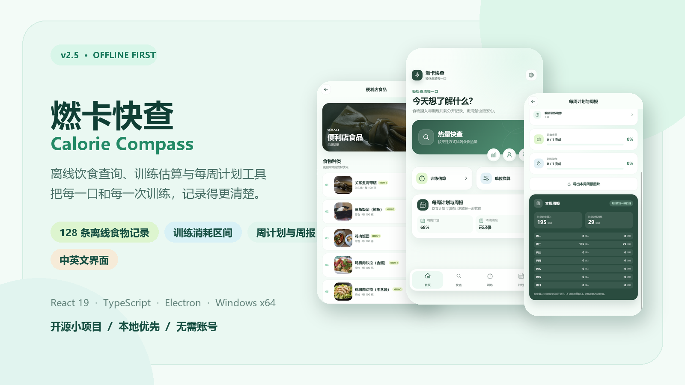
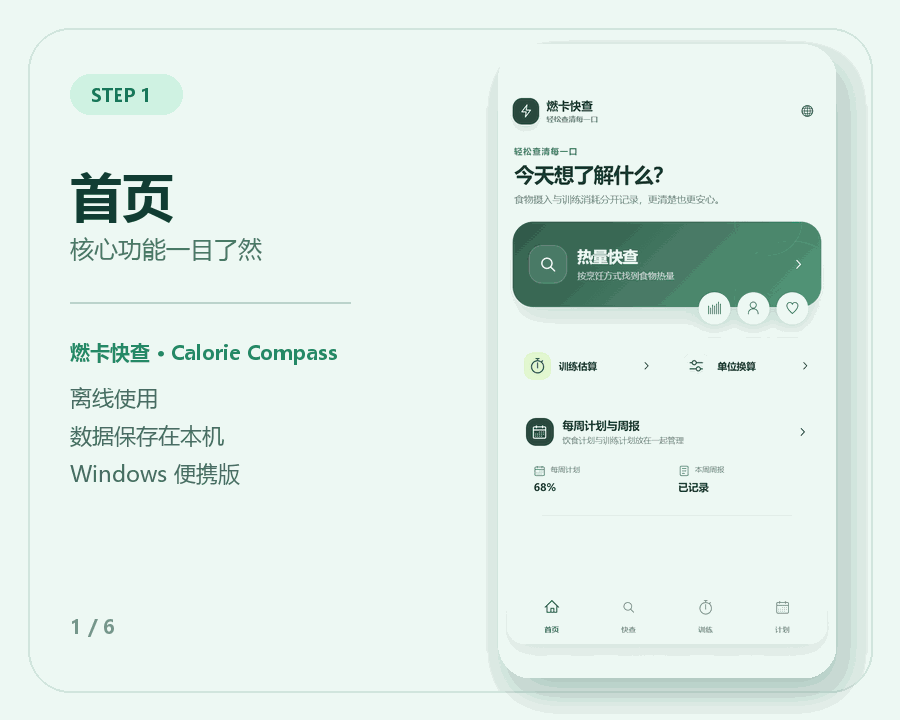
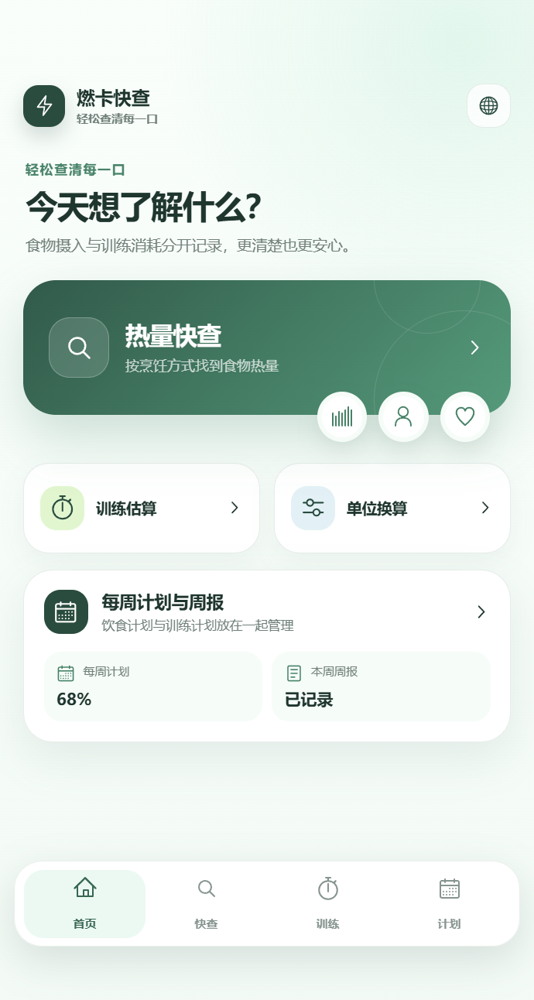
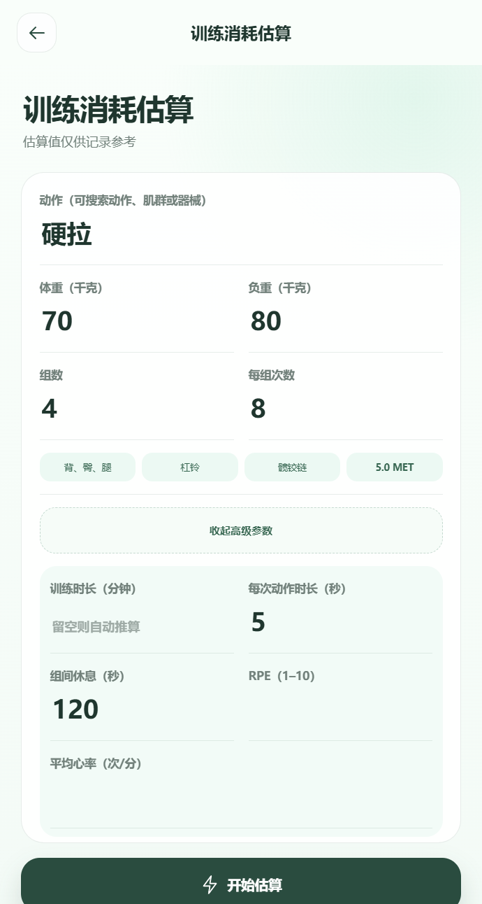
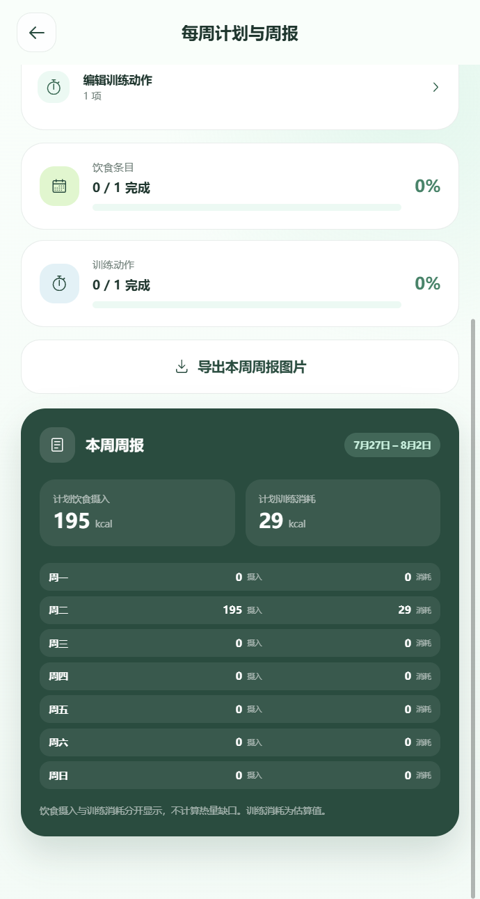
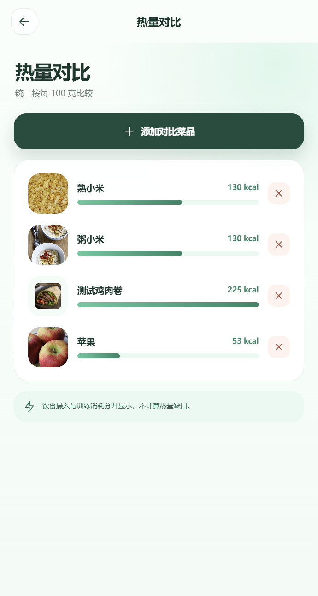

<div align="center">



# 燃卡快查 · Calorie Compass

**离线饮食查询、训练消耗估算与每周计划工具**  
把每一口和每一次训练，记录得更清楚。

[](package.json)
[](https://react.dev/)
[](https://www.typescriptlang.org/)
[](https://www.electronjs.org/)
[](#quick-start)
[](#android)
[](LICENSE)

[🎬 查看 Demo](#demo) · [🖼️ 功能截图](#screenshots) · [✨ 功能一览](#features) · [🚀 快速开始](#quick-start) · [⚠️ 数据说明](#data-disclaimer)

</div>

---

<a id="data-disclaimer"></a>

## ⚠️ 营养数据免责声明

> [!WARNING]
> 内置的食物热量和营养成分来自 USDA FoodData Central 与日本食品标准成分表（八订）增补2023，其中一部分是按相近做法或简单配方推算的估算值（每条都标有可信等级 A/B/C）；份量和训练消耗也是估算。同一种食物的品种、做法和品牌不同，实际数值会有出入；具体产品请以包装标签为准。
>
> **请勿将本项目中的数据用于医疗诊断、疾病管理、专业营养方案、精确减重决策或其他需要高准确度的用途。** 实际饮食与训练决策应以食品标签、可信数据库以及医生或注册营养专业人士的建议为准。

当前版本为 **v2.10**。v2.10 让 Android 版接入 Health Connect：训练估算里给力量动作自动填入手环或手表记录的心率，也可以选择读取体重和静息心率、把勾选完成的训练写回 Health Connect（需要 Android 14 及以上；更低版本照常手填），见 [Health Connect](#health-connect)。

v2.9 新增 Android 版（Android 7.0 及以上，和 Windows 版功能相同），构建方法见 [Android 版](#android)。

v2.6 起遵循“不显示比显示错的好”。v2.7 完成第一批数据重建：目录里的 123 种食物全部换成可追溯的来源数据，并补回蛋白质、碳水、脂肪和纤维；关东煮扩充到 27 种。来源和核对方法见 [数据来源](#data-sources)。

v2.8 重做了训练消耗估算：力量动作按实际做功和肌肉效率计算（53 个动作，按部位和器械分类），有氧按 ACSM 公式和 2024 成人身体活动纲要计算，并用你自己的身高、体重、年龄和性别算静息代谢；每个结果都给出范围、分项和计算依据，依据见 [训练消耗怎么算](#workout-method)。同时新增按实际份量对比、关东煮按串计、份量换算一键记入今天的饮食，以及收藏。

---

<a id="demo"></a>

## 🎬 Demo · 动态演示

<div align="center">



<sub>真实应用界面自动生成：主页 → 热量快查 → 训练估算 → 每周计划 → 单位换算 → 热量对比</sub>

</div>

---

<a id="screenshots"></a>

## 🖼️ 功能截图 · Screenshots

<table>
  <tr>
    <td align="center" width="33%">
      
      <br /><strong>首页</strong><br />核心功能一目了然
    </td>
    <td align="center" width="33%">
      
      <br /><strong>热量快查</strong><br />按场景浏览离线食物目录
    </td>
    <td align="center" width="33%">
      
      <br /><strong>训练估算</strong><br />使用训练参数估算消耗区间
    </td>
  </tr>
  <tr>
    <td align="center" width="33%">
      
      <br /><strong>每周计划与周报</strong><br />编辑计划并导出 PNG 周报
    </td>
    <td align="center" width="33%">
      
      <br /><strong>单位换算</strong><br />kcal 与 kJ 双向换算
    </td>
    <td align="center" width="33%">
      
      <br /><strong>热量对比</strong><br />按每 100 克或实际份量比较
    </td>
  </tr>
</table>

---

<a id="features"></a>

## ✨ 功能一览 · Features

| 功能 | 说明 |
| --- | --- |
| 🔍 热量快查 | 按烹饪方式、便利店食品和营养来源浏览离线食物目录 |
| 🥗 营养详情 | 每 100 克与常见一份的热量、千焦、蛋白质、碳水、脂肪、纤维，以及来源、可信等级和注意事项 |
| 🍢 份量换算 | 按实际克数换算热量和营养素；关东煮按串/个计，每串重量可改；“使用此数据”一键记入今天的饮食 |
| ⚖️ 热量对比 | 目录食物与自定义菜品按每 100 克或按实际份量可视化比较 |
| ❤️ 收藏 | 常吃的食物一键收藏，从首页直接打开 |
| 📝 我的数据 | 添加、编辑和删除自定义菜品，并可导出 / 导入数据备份（含身体数据、收藏和份量设置） |
| 🏋️ 训练估算 | 53 个力量与有氧项目，按做功或运动公式和你的身体数据估算消耗范围；组间休息、动作节奏、RPE、心率为可选项 |
| 📅 每周计划 | 按天编辑饮食与训练计划，分别汇总摄入和训练消耗 |
| 📊 周报导出 | 生成包含七天计划和汇总数据的 PNG 周报 |
| 🔄 单位换算 | 支持 kcal 与 kJ 双向换算 |
| 🌏 双语界面 | 中文与英文界面一键切换 |
| 📴 本地优先 | 核心目录与图片随应用打包，无账号、无云端依赖 |
| 📱 Android 版 | 同一套界面打包成 Android 应用；返回键/返回手势逐级返回，备份存到“下载”、周报图片存到相册 |
| ⌚ Health Connect | Android 14 及以上：力量动作自动填入手环/手表的心率；可选读体重、读静息心率，把勾选完成的训练写回 Health Connect |

---

## 🌿 项目特点

- **离线可用**：核心食物目录、图片和计算逻辑随软件一起打包。
- **饮食与训练分开记录**：不使用“运动抵消饮食”的表达，也不自动计算热量缺口。
- **训练估算讲清依据**：每个结果都能展开看到公式、取值和参考文献。
- **本地数据**：自定义菜品、对比选择、周计划、身体数据和收藏保存在本机，重启和升级后保留，也可以导出成备份文件。
- **桌面便携版**：Electron 构建的 Windows x64 便携应用，无需安装。
- **Android 版**：Capacitor 把同一套界面打包成 Android 应用（APK），离线可用。
- **可继续扩展**：React + TypeScript 代码结构，便于继续补充数据来源和功能。

## 🧰 技术栈

- React 19
- TypeScript 7
- Vite 8
- Electron 43
- Capacitor 8（Android）
- Playwright
- Radix UI Icons

<a id="quick-start"></a>

## 🚀 快速开始

环境要求：Node.js 20 或更高版本、npm。

```bash
git clone https://github.com/SteveBohanMa/calorie-compass.git
cd calorie-compass
npm ci
npm run dev
```

启动桌面应用：

```bash
npm run desktop:run
```

构建 Windows x64 便携版：

```bash
npm run desktop:dist
```

构建产物将生成在 `release-v2.10/`。该目录不会提交到 Git 仓库，可执行文件应通过 GitHub Releases 发布。更多说明见 [README-EXE.md](README-EXE.md)。

<a id="android"></a>

### 📱 Android 版

在 Windows 上双击仓库根目录的 `build-android.cmd`（或运行 `npm run android:apk`）。脚本会：

1. 第一次运行时把构建工具下载到 `%LOCALAPPDATA%\CalorieCompassAndroid`（便携版 JDK 21、Android SDK；已装的 Node.js 低于 22 时再加一个 Node.js 24），不改系统设置。运行即表示同意 Android SDK 的许可条款；
2. `npm install`、`npm test`、`npm run build`；
3. 用 Capacitor 生成或更新 `android/` 工程（`scripts/android/customize-android.mjs` 写入版本号、图标、主题、导出插件和 Health Connect 插件与权限）；
4. 第一次运行时生成签名密钥，放在仓库**外面**的 `../android-signing/`；
5. 在只含英文字符的文件夹里用 Gradle 打包，校验签名和版本后输出 `release-v2.10-android/CalorieCompass-v2.10.0.apk`。

详细过程写在 `build-android.log`。

> [!IMPORTANT]
> 以后每个版本都必须用同一个签名密钥打包，否则手机会拒绝覆盖安装，只能卸载旧版，而卸载会删掉手机上的数据。请备份 `android-signing` 文件夹，不要把它放进仓库。

安装：把 APK 传到手机上点开安装（需要允许“安装未知应用”）。手机上的数据和电脑版相互独立，可以在电脑版“我的数据”里导出备份，再在手机上导入。

<a id="health-connect"></a>

### ⌚ Health Connect（Android 14 及以上）

手环和手表（小米运动健康、三星健康等）把数据同步进系统自带的 Health Connect，燃卡快查再从 Health Connect 读取，不对接各家的私有协议。

- **训练心率**：在训练估算里选力量动作（含循环训练）时，自动把心率填进“平均心率”。手环刚记录了一次运动（正在进行或 2 小时内结束）时，用那次运动的平均心率；否则用最近 5 分钟内最新的一个心率。来源会标在旁边，数值可以改，改过的按手填记录。有氧动作仍然手填。读不到时会说明原因，并给出“重新读取”。
- **体重**：在“我的数据”里开启后，有比身体数据更新的体重时提示更新，确认后才改。
- **静息心率**：只在“我的数据”里显示最近一次和 7 天平均，不参与计算。
- **训练写回**（默认关闭）：勾选“已完成”的训练按每个动作写一条运动记录和活动消耗；取消勾选或删除会同步删掉；同一时间手环已有运动记录时不重复写入。

每项权限都在第一次用到对应功能时才申请，拒绝后照常手填。Android 7–13 的手机上这些功能不显示，其余功能不受影响。

## ✅ 检查与测试

```bash
npm test               # 运行时完整性、数据校验、Sites、Android 构建脚本与 Playwright 页面测试（含手机尺寸）
npm run test:desktop   # 构建后启动 Electron：重启后数据保留、协议安全、启动无报错
```

也可以单独运行 `npm run check:runtime`、`npm run test:data`、`npm run test:sites`、`npm run test:android-build`、`npm run test:runtime`。

首次运行 Playwright 测试前，需要安装对应浏览器：

```bash
npx playwright install chromium
```

README 展示素材可以通过真实 Electron 界面重新生成：

```bash
npm run build
npx electron . --verify-output=verification-readme-v25
python scripts/generate-readme-assets.py
```

## 📁 项目结构

```text
android/        Capacitor 生成的 Android 工程（版本、图标、主题由 scripts/android/ 写入）
desktop/        Electron 主进程与预加载脚本
docs/readme/    README 的 Intro、Demo 与功能截图
public/         随应用打包的本地图片和静态资源
data-sources/   营养数据源清单、来源核对表与待补清单（原始文件不进 Git）
scripts/        数据、资源、构建与 README 素材脚本（营养数据流水线在 scripts/nutrition/，Android 打包在 scripts/android/）
src/
  Prototype.tsx 页面导航与全局状态
  app/          共用文案、烹饪方式、食物存取与小组件
  screens/      各个页面（首页、快查、详情、对比、收藏、我的数据、换算）
  features/     份量换算、收藏、按份量对比
  workout/      训练动作库、能量模型、身体数据与训练估算页面
  native/       Android 应用的返回键与文件导出（Capacitor）
  health/       Health Connect（Android 14+）：心率、体重、静息心率与训练写回
  mobile/       锁定的移动端运行时（不要修改）
tests/          Playwright 与 Sites 测试（训练模型另有纯计算测试）
worker/         静态站点路由 Worker
```

<a id="workout-method"></a>

## 🏋️ 训练消耗怎么算

结果都是“范围”，不是精确值：同一组动作，不同研究测得的消耗能差 3 倍以上，个人差异也很大。

- **力量训练**：每组做功 = 次数 × 动作幅度（按身高比例）×（负重 + 随动作抬起的那部分体重）。额外消耗 = 做功 ÷ 肌肉效率；效率按动作类型取已发表研究的范围（下肢复合动作约 6.5%–23%，上肢约 5.5%–12%，孤立动作约 4%–8%）。Scott 2012/2014、Dudley 1991、Brown 1994、Nakagata 2022、Vezina 2014 的实测值都在模型范围内，测试会检查这一点。
- **消耗发生在什么时候**：按摄氧量的上升和恢复速度（Özyener 2001）分成组内做功、组间恢复和练后恢复（EPOC）。
- **组间休息**：填写后计入组间恢复和这段时间的静息代谢，显示总消耗；不填只显示训练部分，并提示哪些没计入。练后恢复始终计入。
- **有氧**：步行、跑步、功率车用 ACSM 代谢公式；划船机、椭圆机、楼梯机、跳绳、HIIT、循环训练等用 2024 成人身体活动纲要（Herrmann 2024）。额外消耗减去的是用你的身体数据算出的静息代谢（Mifflin–St Jeor），而不是统一的 3.5 mL/kg/min，后者对体重较大的人偏高。
- **可选输入**：平均心率（举重用 Collins 1991，有氧用 Keytel 2005）和主观用力 RPE 会按各自的可靠程度并入结果；超出合理范围的心率不会被使用，界面会说明原因。Android 14 及以上可以从 Health Connect 自动读取力量动作的心率（见 [Health Connect](#health-connect)），计算方法不变。
- **身体数据**：性别、年龄、身高、体重只保存在本机，可在“我的数据”里随备份导出。v2.7 及更早版本里的训练记录是占位数字，升级后会被清除。

<a id="data-sources"></a>

## 🗺️ 数据来源

| 来源 | 用途 | 许可 |
| --- | --- | --- |
| [USDA FoodData Central](https://fdc.nal.usda.gov/)（SR Legacy、Foundation Foods） | 肉蛋鱼虾、主食、蔬果、坚果，以及同一食材的不同做法 | 公共领域（CC0） |
| [日本食品標準成分表（八訂）増補2023年](https://www.mext.go.jp/a_menu/syokuhinseibun/index.htm) | 关东煮食材，以及日本表有实测熟制值的条目 | 文部科学省允许自由使用，需注明出处 |

每条记录都写明来源数据库和条目编号（FDC ID 或食品番号）。可信等级：

- **A**：来源里直接有这种做法的熟制值；
- **B**：用相近做法近似，或用已核实的食材按简单配方推算；
- **C**：各家产品差别大（便利店饭团、便当、鱼糜制品等），只给典型值，以包装为准。

数据由脚本生成，不手抄数字：

```bash
fetch-nutrition-sources.cmd                    # Windows 双击，或 node scripts/fetch-nutrition-sources.mjs
python scripts/nutrition/build_catalog.py      # 按 scripts/nutrition/catalog_spec.py 生成 src/foods.json
npm run test:data                              # 结构、来源、营养素与热量一致性检查
```

`data-sources/source-values.json` 记录每个数值对应的来源条目和交叉核对结果；`data-sources/pending.csv` 是还在等数据的食物（等中国食物成分表，或等包装标签）。等数据的记录标记为 `"DataStatus": "pending"`，不会在应用中显示。

欢迎针对软件功能、界面、可访问性和工程实现提交 Issue 或 Pull Request。涉及营养数据的修改，请同时提供可核查的数据来源。

## 🔒 隐私

应用不要求注册账号。自定义菜品、对比选择、周计划、身体数据（性别、年龄、身高、体重，以及选填的运动水平、最大心率和最大摄氧量）、收藏和份量设置都只保存在用户本机，项目本身不提供云端同步服务；需要换电脑或换到手机时，可在“我的数据”中导出备份文件再导入。Android 版同样只把数据保存在手机上，不申请存储、位置等权限；Health Connect 的健康数据权限（心率、运动记录、体重、静息心率、写入训练）只在你开启对应功能时申请，读到的数据只在手机上处理，不会上传，可以随时在 Health Connect 设置里撤销。备份文件包含身体数据，请自行妥善保管；Health Connect 的开关和写回记录只属于这台手机，不进备份。

## 📄 许可

项目代码采用 [MIT License](LICENSE)。仓库中的第三方字体、图标和图片仍分别受其原始许可约束；食物图片来源记录位于 `public/assets/food/ATTRIBUTION*.md`，新增关东煮条目的图标来自 Noto Emoji（Apache License 2.0）。

营养数据：USDA FoodData Central（公共领域）；日本食品標準成分表（八訂）増補2023年から引用（文部科学省）。

---

本项目按“现状”提供，不附带任何形式的准确性、适用性或特定用途保证。
